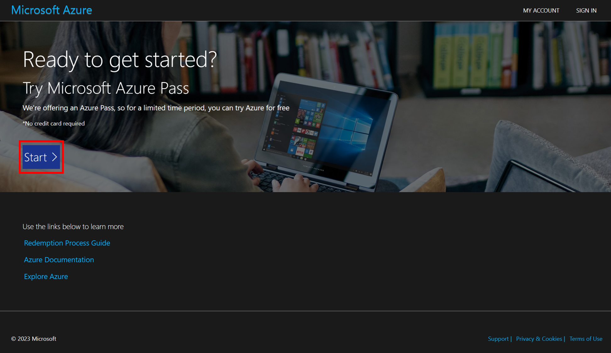
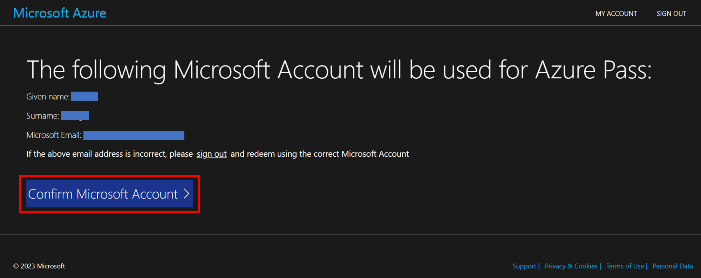
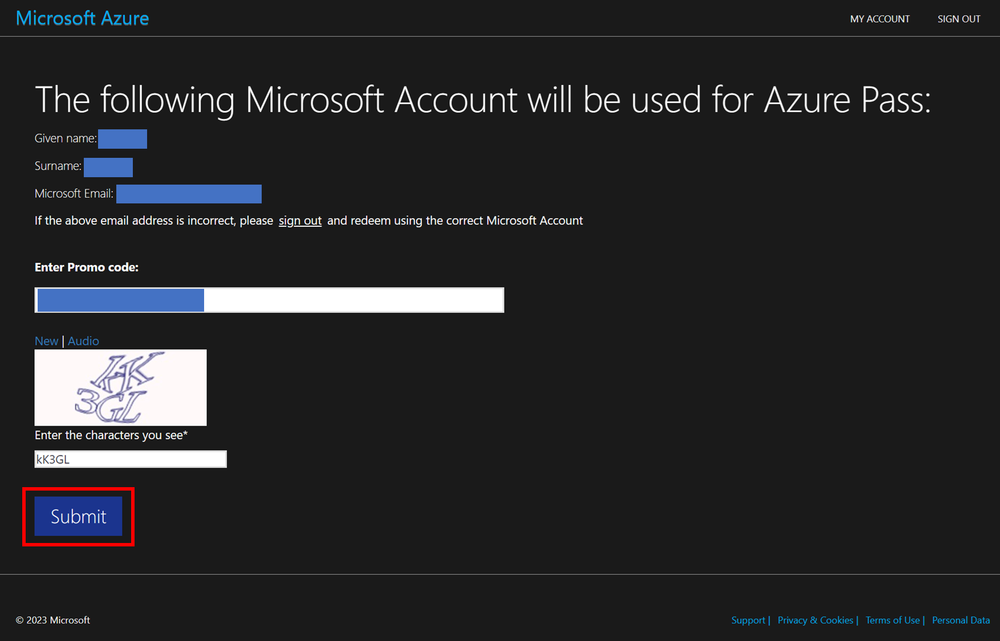
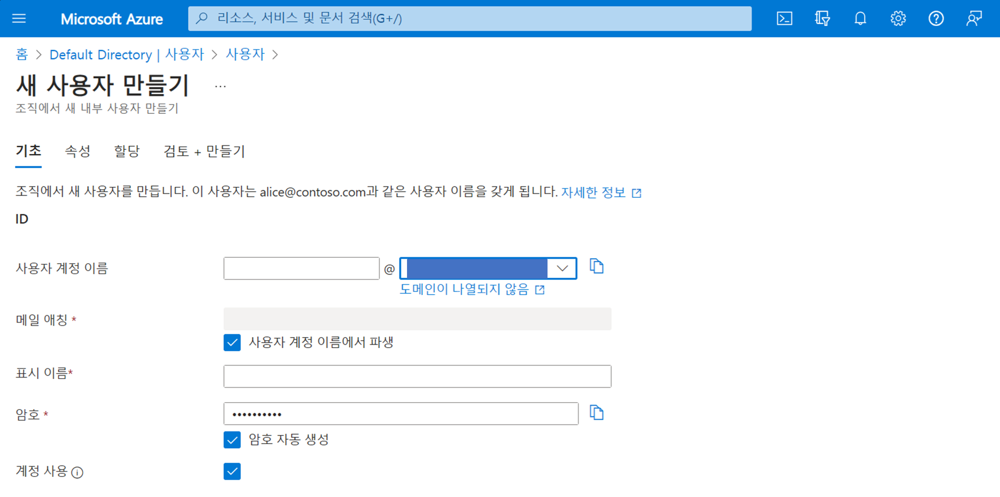

# 00. 사전 준비

## 개요와 학습 목표

Azure Pass를 활성화하고 Microsoft Entra ID 사용자를 생성합니다. Azure Pass를 사용하는 행사에서는 이 문서의 계정·구독 준비를 마친 뒤 Basic 실습을 진행합니다.

## 사전 요구사항

- Azure Pass 활성화에 사용할 개인 Microsoft 계정
- 운영자가 제공한 Azure Pass 프로모 코드
- Azure Portal 로그인과 Microsoft Entra ID 사용자 생성에 필요한 권한

<!-- TODO: 저자 확인 — Azure Pass를 사용하지 않는 수강자의 준비 경로와 사용자 생성 권한 -->

## 소요 시간

예상 소요 시간은 약 10분이며, [워크샵 전체 agenda](../README.md#소요-시간)(4시간)를 기준으로 배분했습니다.

<!-- TODO: 저자 확인 — 실제 완주 시간과의 차이 -->

## 실습 단계

1. [Azure Pass 활성화](#azure-pass-활성화)
2. [Azure 사용자 생성](#azure-사용자-생성)

### Azure Pass 활성화

1. [https://www.microsoftazurepass.com/](https://www.microsoftazurepass.com/) 에 접속합니다.

    * 브라우저에 Azure 자동 로그인이 되어 있는 경우, 브라우저의 **인프라이빗 모드**를 사용해 주세요.

2. 화면의 Start 버튼을 클릭합니다.

    

3. (중요) 이 때 꼭 학교나 회사 계정이 아닌 **“개인 계정”**을 사용하셔야 합니다.
4. 로그인이 되면 아래 화면이 보입니다. 아래 화면에서 Confirm Microsoft Account 버튼을 클릭합니다.

    

5. Enter Promo code: 입력 상자에 관리자에게 전달 받은 프로모 코드를 입력합니다.
6. CAPTCHA를 입력하고 Submit 버튼을 클릭합니다.

    

### Azure 사용자 생성

1. 애저 포털([https://portal.azure.com/](https://portal.azure.com/))에 접속합니다.
2. 상단 메뉴 검색에서 Entra ID를 검색하여 결과에서 Microsoft Entra ID 를 클릭합니다.
3. 왼쪽 메뉴에서 사용자를 클릭합니다.
4. 새 사용자 버튼을 클릭하고 새 사용자 만들기를 선택합니다.
5. 사용자 정보를 입력하고 검토 + 만들기 버튼을 클릭합니다.

    

6. 필요한 사용자 수 만큼 4~5단계를 반복합니다.

## 검증

Azure Pass의 프로모 코드 입력 절차를 마쳤는지 확인합니다. Microsoft Entra ID 사용자 목록에서 실습에 필요한 사용자가 생성되었는지 확인한 뒤 Basic으로 이동합니다.

<!-- TODO: 저자 작성 — Azure Pass 활성화 완료를 확인할 화면과 구독 상태 -->

## 정리 (Clean-up)

이 단계에서 준비한 계정과 구독은 뒤의 실습에 사용합니다. 사용자와 구독의 정리 범위는 행사 운영자에게 확인합니다.

<!-- TODO: 저자 작성 — 행사 종료 후 사용자·구독 처리 범위와 담당자 -->

## 트러블슈팅

<!-- TODO: 저자 작성 — 실제 확인한 오류와 해결 방법 -->

## 이전·다음

[이전: 워크샵 홈](../README.md) · [다음: Basic](../01-basic/README.md)